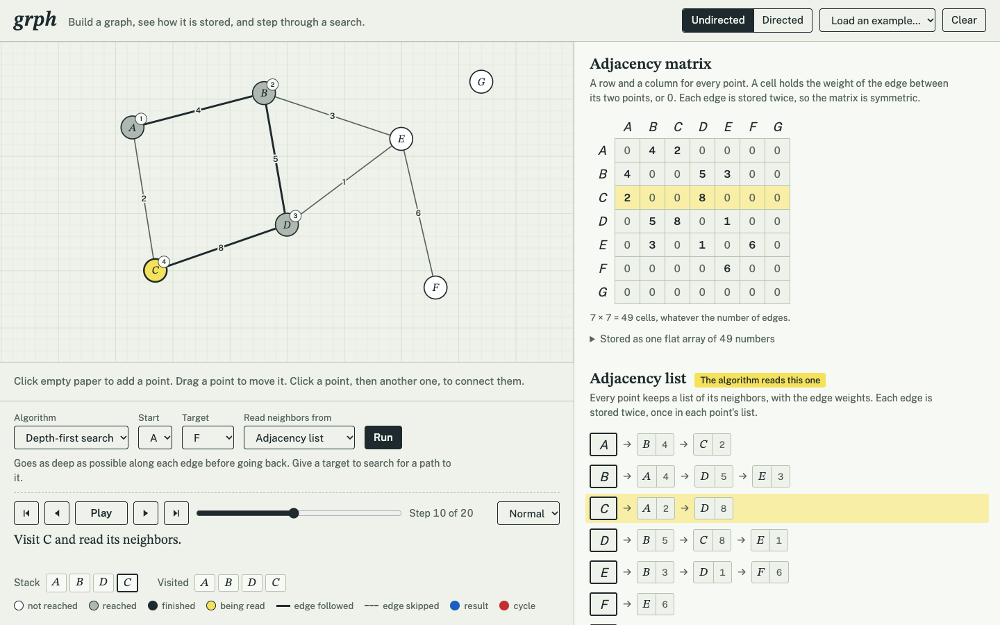

# grph

A TypeScript project for learning how graphs work. It stores a graph in three standard ways and runs graph searches on them. A browser visualizer lets you build a graph and watch each structure change as you edit. You can also step through a search and see which part of each structure the algorithm reads at every step.



## The visualizer

```sh
npm install
npm run dev     # then open the printed address, usually http://localhost:5173
```

- **Build a graph.** Click empty paper to add a point. Drag a point to move it. Click a point and then another point to connect them. Click an edge to change its weight, and press Delete to remove the selected point or edge. Switch between undirected and directed edges, or load one of the examples.
- **See how it is stored.** The adjacency matrix (and the flat array it is stored in), the adjacency list and the incidence matrix update on every edit. Each one shows how many cells or entries it uses. Clicking a point or edge in a structure selects it in the drawing.
- **Step through an algorithm.** Pick an algorithm, its start and target, and which representation it reads neighbours from, then press Run. You can step back and forward, play automatically, or use ← → and Space. Each step says what is happening. Points are coloured the way textbooks colour them: white = not reached, gray = reached, black = finished. A highlighter marks what the algorithm is reading, both in the drawing and in all three structures.

The graph is saved in your browser, so it is still there after a reload.

## Run with Docker

You only need Docker; Node.js doesn't have to be installed.

```sh
docker compose up --build        # http://localhost:8080
```

This type-checks the code, runs the tests and builds the visualizer, then serves it with nginx. The image won't build if a check fails.

```sh
docker compose up --build dev    # http://localhost:5173, reloads when you edit files
```

This runs the Vite dev server on your local source files.

Set `WEB_PORT` or `DEV_PORT` to use other ports, for example `WEB_PORT=3000 docker compose up --build`. Stop with Ctrl+C, or with `docker compose down` when the app runs in the background (`-d`). After changing dependencies, add `--renew-anon-volumes` to the dev command so the container installs them again.

There is no separate backend: the graph library in `src/` is bundled into the visualizer and runs in the browser.

## Graph representations

All three classes implement the same `Graph` interface (`src/graph/interfaces/graph.ts`):

```ts
interface Graph {
    readonly directed: boolean;

    addPoint(name: string): this;
    removePoint(name: string): this;
    hasPoint(name: string): boolean;
    getPoints(): string[];

    addEdge(nameX: string, nameY: string, weight?: number): this;
    removeEdge(nameX: string, nameY: string): this;
    hasEdge(nameX: string, nameY: string): boolean;
    getEdges(): Edge[];

    getNeighbors(name: string): Neighbor[];
    print(): string;
}
```

| Class | How the graph is stored | Memory |
|---|---|---|
| `AdjacencyMatrix` | A row and a column per point, in one flat array. Cell `[x][y]` holds the weight of edge x→y, or 0 | points² |
| `AdjacencyList` | A `Map` from each point to its neighbours and the edge weights | points + edge ends |
| `IncidenceMatrix` | A row per point and a column per edge. Undirected: the weight in both rows. Directed: −weight where the edge leaves, +weight where it enters | points × edges |

Every representation follows the same rules:

- Graphs can be undirected or directed: `new AdjacencyList(true)`.
- There is at most one edge between two points (one per direction in a directed graph). Adding an edge that already exists replaces its weight.
- Weights are positive numbers. They can't be 0 because the matrices use 0 to mean "no edge". Self-loops are not allowed.
- `addEdge` creates missing points. The other methods throw a `GraphError` when a point or edge doesn't exist.
- `getNeighbors` returns neighbours in the order the structure stores them. A matrix row is read in point order, while a list is read in the order the edges were added. Because of this, a search can visit points in a different order depending on the representation.

## Algorithms

```ts
import { AdjacencyList, dfs, topologicalSort } from "grph";

const graph = new AdjacencyList().addEdge("A", "B").addEdge("A", "C").addEdge("B", "D");
dfs(graph, "A").order;          // ["A", "B", "D", "C"]
dfs(graph, "A", "D").path;      // ["A", "B", "D"]

const tasks = new AdjacencyList(true).addEdge("shirt", "tie").addEdge("tie", "jacket");
topologicalSort(tasks).order;   // ["shirt", "tie", "jacket"]
```

- **Depth-first search** (`src/algorithms/dfs.ts`) starts at one point and goes as deep as possible before going back. If you give a target, it stops there and returns the path.
- **Topological sort** (`src/algorithms/topological-sort.ts`) orders the points of a directed graph so that every edge goes forward. If the graph has a cycle, it returns that cycle instead, because then no such order exists.

Each algorithm also returns `steps`: a snapshot per step of the point and edge marks, its stack or result lists, and what it is reading. The visualizer replays these snapshots. To add an algorithm (BFS and Dijkstra are next), record its steps with a `Tracer` (`src/algorithms/trace.ts`) and add it to the list in `src/algorithms/index.ts`. The visualizer picks it up from there.

## Scripts

| Command | What it does |
|---|---|
| `npm run dev` | Starts the visualizer with live reload |
| `npm test` | Runs the tests (Vitest) |
| `npm run build` | Compiles the library from `src/` to `dist/` |
| `npm run build:ui` | Builds the visualizer as a static site in `dist-ui/` |
| `npm run typecheck` | Type-checks the library and the visualizer |

The scripts in `test/manual-*.js` print each structure to the terminal. Run `npm run build` first, then for example `node test/manual-adjacency-m.js`.

## Project structure

```
src/                          the library
├── index.ts                  everything it exports
├── graph/
│   ├── adjacency-matrix.ts
│   ├── adjacency-list.ts
│   ├── incidence-matrix.ts
│   ├── point.ts              a named point with its row/column index
│   ├── validation.ts         shared rules and GraphError
│   └── interfaces/           Graph, Edge, Neighbor, Point
└── algorithms/
    ├── dfs.ts
    ├── topological-sort.ts
    ├── trace.ts              step recording for replay
    ├── algorithm.ts          the interface the visualizer runs
    └── index.ts              the list of algorithms
ui/                           the visualizer (Vite, no framework)
└── src/
    ├── model.ts              applies each edit to all three structures
    ├── canvas.ts             drawing and editing
    ├── structures.ts         the three structure views
    ├── player.ts             running and replaying algorithms
    └── presets.ts            example graphs
test/                         Vitest tests and manual print scripts
```

## References

- [Graph and its representations (GeeksforGeeks)](https://www.geeksforgeeks.org/graph-and-its-representations/)
- [Graph theory: applications (Wikipedia)](https://en.wikipedia.org/wiki/Graph_theory#Applications)
- [Depth-first search (Wikipedia)](https://en.wikipedia.org/wiki/Depth-first_search)
- [Topological sorting (Wikipedia)](https://en.wikipedia.org/wiki/Topological_sorting)
- [Topological sort kata (Codewars)](https://www.codewars.com/kata/55f10facf351f5e236000014)

## License

ISC
