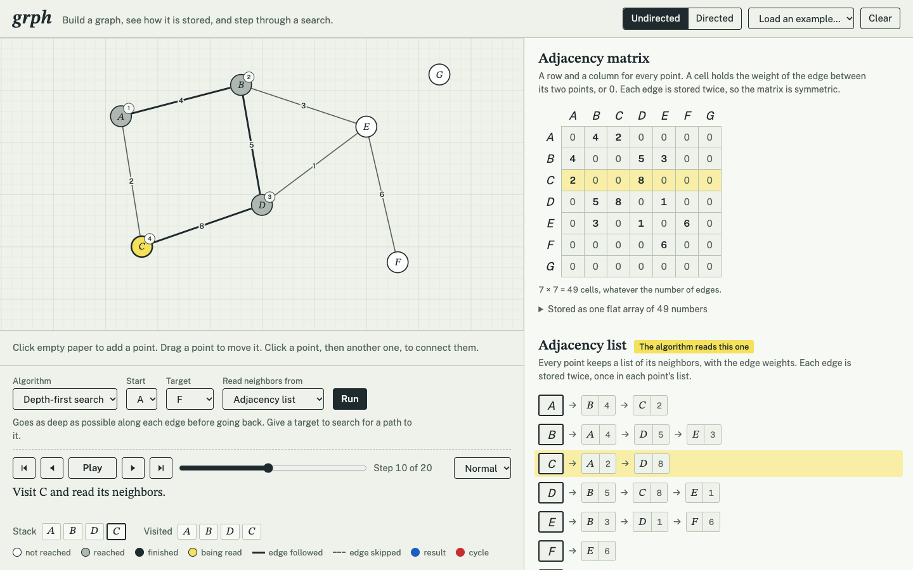

# grph

English: [README.md](README.md)

Проєкт на TypeScript, щоб розібратися, як працюють графи. Він зберігає граф трьома стандартними способами і виконує на них пошук. У браузерному візуалізаторі можна будувати граф і дивитися, як змінюється кожна структура під час редагування. А ще можна проходити пошук крок за кроком і бачити, яку частину кожної структури алгоритм читає на кожному кроці.



## Візуалізатор

Спробувати онлайн: **https://xenarro.github.io/grph/**

Кожен пуш у `master` перевіряє типи, запускає тести й публікує візуалізатор на GitHub Pages (`.github/workflows/pages.yml`).

Щоб запустити локально:

```sh
npm install
npm run dev     # потім відкрий показану адресу, зазвичай http://localhost:5173
```

Підписи на кнопках залишаються англійською, тому нижче вони наведені так, як на сторінці.

- **Будуй граф.** Клацни на порожньому папері, щоб додати вершину. Перетягни вершину, щоб її пересунути. Клацни одну вершину, потім іншу, щоб їх з'єднати. Клацни ребро, щоб змінити його вагу, і натисни Delete, щоб видалити виділену вершину чи ребро. Перемикай неорієнтовані й орієнтовані ребра, завантажуй приклади або генеруй випадковий граф на 100–100 000 вершин. Серед прикладів є великі графи на 10 000 і 100 000 вершин: у коді лише їхні рецепти, а сам граф генерується, коли його обираєш.
- **Рухайся.** Коліщатко, щипок на трекпаді або два пальці змінюють масштаб, перетягування порожнього паперу рухає вид. **Fit** показує весь граф. Вершини показують імена, коли достатньо великі на екрані, і стають точками, коли в кадрі весь великий граф.
- **Дивись, як він зберігається.** Матриця суміжності (і плаский масив, у якому вона лежить), список суміжності й матриця інцидентності оновлюються при кожній зміні. Кожна показує, скільки клітинок чи записів займає, і має власний розділ **How it works**: ідею, невеликий шматок TypeScript і те, для чого вона добра, а для чого ні. Клік по вершині чи ребру в структурі виділяє їх і на малюнку.
- **Порівнюй структури.** **Which structure for what** для графа на сторінці рахує, скільки пам'яті займає кожна структура і скільки роботи вона робить, щоб перевірити ребро, перелічити сусідів вершини, додати вершину чи ребро та обійти весь граф. Найменше в кожному рядку підсвічено.
- **Шукай найкоротший шлях.** Клацни вершину й натисни **Start here**, клацни іншу й натисни **Target here**, а потім запусти **Shortest path (Dijkstra)** для найлегшого шляху або **Breadth-first search** для шляху з найменшою кількістю ребер. Шлях стає синім, а кожна вершина показує свою відстань.
- **Розбирайся, як це працює.** У розділі **How it works** пояснено обраний алгоритм: для чого він, ідея, псевдокод, той самий алгоритм на TypeScript, скільки він коштує в кожній структурі, коли його брати й коли ні та що спробувати тут. Поки алгоритм працює, рядок поточного кроку в псевдокоді підсвічено.
- **Читай українською.** Перемикач мови вгорі переводить пояснення й описи українською; кнопки й повідомлення кроків лишаються англійською. Приклади коду однакові для обох мов.
- **Проходь алгоритм кроками.** Обери алгоритм, його старт і ціль та структуру, з якої він читає сусідів, і натисни Run. Можна йти вперед і назад, грати автоматично або користуватися ← → і пробілом. Кожен крок пояснює, що відбувається. Вершини розфарбовано, як у підручниках: біла — не досягнута, сіра — досягнута, чорна — завершена. Маркер позначає те, що алгоритм зараз читає, і на малюнку, і в усіх трьох структурах.

### Великі графи

Список суміжності росте з кількістю вершин + ребер, а дві матриці — з вершинами × вершини та вершинами × ребра. Тож граф тримає список, а матриці будуються з нього, лише поки граф у них уміщується:

| Структура | Будується для | На межі |
|---|---|---|
| Список суміжності | до 100 000 вершин і 300 000 ребер | близько 50 МБ |
| Матриця суміжності | до 1 000 вершин | 1 000 000 клітинок, 8 МБ |
| Матриця інцидентності | до 1 000 вершин і 3 000 000 клітинок | близько 36 МБ |

Для більшого графа замість матриці показано, скільки вона коштувала б (100 000 вершин потребували б 10 000 000 000 клітинок, близько 80 ГБ), і алгоритм не може з неї читати. Понад 40 вершин матриця малюється картинкою, по пікселю на клітинку, а понад 200 вершин список показує лише видимі рядки.

Запуск алгоритму зберігає перші 100 000 кроків по одному, а решту — як один останній крок, тож пошук на 100 000 вершинах займає небагато пам'яті.

Граф зберігається в браузері, тож після перезавантаження він на місці. Граф понад 5 000 вершин не вміщується в сховище браузера, тому згенерований граф зберігається як рецепт, з якого його зроблено, а правки в ньому не зберігаються.

## Запуск у Docker

Потрібен лише Docker; Node.js встановлювати не обов'язково.

```sh
docker compose up --build        # http://localhost:8080
```

Це перевіряє типи, запускає тести, збирає візуалізатор і віддає його через nginx. Образ не збереться, якщо якась перевірка не пройде.

```sh
docker compose up --build dev    # http://localhost:5173, перезавантажується, коли змінюєш файли
```

Це запускає сервер розробки Vite на твоїх локальних файлах.

Задай `WEB_PORT` або `DEV_PORT`, щоб змінити порти, наприклад `WEB_PORT=3000 docker compose up --build`. Зупинити можна через Ctrl+C або `docker compose down`, якщо застосунок працює у фоні (`-d`). Після зміни залежностей додай `--renew-anon-volumes` до команди dev, щоб контейнер встановив їх заново.

Окремого бекенду немає: бібліотека графів із `src/` вбудована у візуалізатор і працює в браузері.

## Представлення графа

Усі три класи реалізують той самий інтерфейс `Graph` (`src/graph/interfaces/graph.ts`):

```ts
interface Graph {
    readonly directed: boolean;

    addPoint(name: string): this;
    removePoint(name: string): this;
    hasPoint(name: string): boolean;
    getPoints(): string[];

    addEdge(nameX: string, nameY: string, weight?: number): this;
    removeEdge(nameX: string, nameY: string): this;
    hasEdge(nameX: string, nameY: string): boolean;
    getEdges(): Edge[];

    getNeighbors(name: string): Neighbor[];
    print(): string;
}
```

| Клас | Як зберігається граф | Пам'ять |
|---|---|---|
| `AdjacencyMatrix` | Рядок і стовпець на вершину в одному пласкому `Float64Array`. Клітинка `[x][y]` містить вагу ребра x→y або 0 | вершини² × 8 байтів |
| `AdjacencyList` | `Map` від кожної вершини до її сусідів і ваг ребер | вершини + кінці ребер |
| `IncidenceMatrix` | Рядок на вершину і стовпець на ребро. Неорієнтоване ребро: вага в обох рядках. Орієнтоване: −вага там, звідки ребро виходить, +вага там, куди входить | вершини × ребра |

Усі представлення дотримуються тих самих правил:

- Граф може бути неорієнтованим або орієнтованим: `new AdjacencyList(true)`.
- Між двома вершинами щонайбільше одне ребро (по одному в кожному напрямку для орієнтованого графа). Додавання наявного ребра замінює його вагу.
- Ваги — додатні числа. Вони не можуть бути 0, бо матриці позначають нулем «немає ребра». Петлі заборонені.
- `addEdge` створює відсутні вершини. Інші методи кидають `GraphError`, якщо вершини чи ребра немає.
- `addPoints` додає багато вершин за раз; матриця розширюється один раз для всіх, а не для кожної окремо.
- `convert(source, target)` копіює граф в інше представлення: `convert(list, new AdjacencyMatrix(list.directed))`.
- `getNeighbors` повертає сусідів у тому порядку, в якому їх зберігає структура. Рядок матриці читається в порядку вершин, а список — у порядку додавання ребер. Тому пошук може обходити вершини в різному порядку залежно від представлення.

## Алгоритми

```ts
import { AdjacencyList, bfs, dfs, dijkstra, topologicalSort } from "grph";

const graph = new AdjacencyList().addEdge("A", "B").addEdge("A", "C").addEdge("B", "D");
dfs(graph, "A").order;          // ["A", "B", "D", "C"]
dfs(graph, "A", "D").path;      // ["A", "B", "D"]

// A–B–C важить 1 + 1, пряме ребро A–C важить 5
const roads = new AdjacencyList().addEdge("A", "B", 1).addEdge("B", "C", 1).addEdge("A", "C", 5);
dijkstra(roads, "A", "C").path; // ["A", "B", "C"], найлегший: сумарна вага 2
bfs(roads, "A", "C").path;      // ["A", "C"], найменше ребер

const tasks = new AdjacencyList(true).addEdge("shirt", "tie").addEdge("tie", "jacket");
topologicalSort(tasks).order;   // ["shirt", "tie", "jacket"]
```

- **Пошук у глибину** (`src/algorithms/dfs.ts`) починає з однієї вершини й іде якомога глибше, перш ніж повернутися. Якщо задано ціль, зупиняється на ній і повертає шлях.
- **Пошук у ширину** (`src/algorithms/bfs.ts`) обходить вершини кільцями навколо старту, тож знаходить шлях із найменшою кількістю ребер. Ваги не враховуються.
- **Алгоритм Дейкстри** (`src/algorithms/dijkstra.ts`) знаходить найлегший шлях від старту до кожної вершини. Він тримає досягнуті вершини в черзі з пріоритетом (бінарній купі, `src/algorithms/priority-queue.ts`) і щоразу завершує найближчу. Якщо задано ціль, зупиняється на ній і повертає шлях і його сумарну вагу.
- **Топологічне сортування** (`src/algorithms/topological-sort.ts`) впорядковує вершини орієнтованого графа так, що кожне ребро веде вперед. Якщо в графі є цикл, повертає цей цикл, бо тоді такого порядку не існує.

Кожен алгоритм також повертає `steps` — це `Trace`: `steps.at(i)` дає позначки вершин і ребер на кроці i, стек чи списки результатів і те, що алгоритм читає. Крок зберігає лише те, що змінилося, разом зі старими значеннями, тож запис рухається вперед і назад, застосовуючи або скасовуючи зміни. Пошуки в глибину тримають власний стек замість того, щоб викликати самі себе, тож працюють на графах, набагато глибших за стек викликів JavaScript. Щоб додати алгоритм, записуй його кроки через `Tracer` (`src/algorithms/trace.ts`) і додай його до списку в `src/algorithms/index.ts`. Візуалізатор підхопить його звідти.

## Скрипти

| Команда | Що робить |
|---|---|
| `npm run dev` | Запускає візуалізатор з автоперезавантаженням |
| `npm test` | Запускає тести (Vitest) |
| `npm run build` | Компілює бібліотеку з `src/` у `dist/` |
| `npm run build:ui` | Збирає візуалізатор як статичний сайт у `dist-ui/` |
| `npm run typecheck` | Перевіряє типи бібліотеки й візуалізатора |

Скрипти `test/manual-*.js` друкують кожну структуру в терміналі. Спершу виконай `npm run build`, потім, наприклад, `node test/manual-adjacency-m.js`.

## Структура проєкту

```
src/                          бібліотека
├── index.ts                  усе, що вона експортує
├── graph/
│   ├── adjacency-matrix.ts
│   ├── adjacency-list.ts
│   ├── incidence-matrix.ts
│   ├── convert.ts            копіює граф в інше представлення
│   ├── point.ts              іменована вершина з індексом рядка/стовпця
│   ├── validation.ts         спільні правила і GraphError
│   └── interfaces/           Graph, Edge, Neighbor, Point
└── algorithms/
    ├── dfs.ts
    ├── bfs.ts
    ├── dijkstra.ts
    ├── priority-queue.ts     бінарна купа для черги Дейкстри
    ├── topological-sort.ts
    ├── trace.ts              запис кроків для відтворення
    ├── algorithm.ts          інтерфейс, який запускає візуалізатор
    └── index.ts              список алгоритмів
ui/                           візуалізатор (Vite, без фреймворку)
└── src/
    ├── model.ts              список, і матриці, поки граф у них уміщується
    ├── canvas.ts             малювання на canvas, масштаб і редагування
    ├── structures.ts         три структури на сторінці
    ├── structure-guide.ts    "Which structure for what" і "How it works" кожної структури
    ├── structure-explainers.ts  їхні тексти й TypeScript
    ├── grid-picture.ts       велика матриця картинкою, по пікселю на клітинку
    ├── list-window.ts        великий список, лише видимі рядки
    ├── player.ts             запуск і відтворення алгоритмів
    ├── explainer.ts          "How it works" для обраного алгоритму
    ├── explainers.ts         його текст, псевдокод і TypeScript
    ├── i18n.ts               мови пояснень: англійська й українська
    ├── generate.ts           випадкові графи будь-якого розміру
    └── presets.ts            приклади графів
test/                         тести Vitest і скрипти для друку
```

## Посилання

- [Graph and its representations (GeeksforGeeks)](https://www.geeksforgeeks.org/graph-and-its-representations/)
- [Graph theory: applications (Wikipedia)](https://en.wikipedia.org/wiki/Graph_theory#Applications)
- [Depth-first search (Wikipedia)](https://en.wikipedia.org/wiki/Depth-first_search)
- [Topological sorting (Wikipedia)](https://en.wikipedia.org/wiki/Topological_sorting)
- [Topological sort kata (Codewars)](https://www.codewars.com/kata/55f10facf351f5e236000014)

## Ліцензія

ISC
